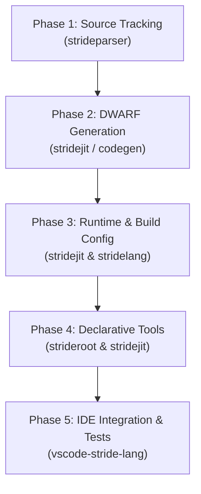

# Stride Debugging Architecture & Implementation Plan

This document outlines the concrete, phased engineering roadmap for implementing source-level debugging in Stride. It enables seamless integration with standard debuggers (**GDB**, **LLDB**) and modern IDEs (**VS Code**, **CLion**, **Qt Creator**) for both AOT-compiled objects (`.o` + `.h`) and in-memory JIT execution (`stridejit`).

---

## 1. Architectural Overview

```
                      Stride Source (.stride)
                                 │
                     strideparser / codegen
             (AST with line, column, relative & absolute paths)
                                 │
                  ┌──────────────┴──────────────┐
                  ▼                             ▼
         [ Lowering Engine ]           [ StrideDebugEmitter ]
         - Scalar vs Vector            - llvm::DIBuilder
         - Unroll vs Loop              - DICompileUnit / DIFile
         - ElementContext              - DISubprogram / DILocation
                  │                    - DILocalVariable / DITypes
                  └──────────────┬──────────────┘
                                 │
                         LLVM IR + DWARF
                                 │
            ┌────────────────────┴────────────────────┐
            ▼                                         ▼
   [ AOT Compilation ]                       [ JIT Execution ]
   - stridec CLI driver                      - stridejit ExecutionEngine
   - emitObjectFile (.o / .obj)              - GDBRegistrationListener
   - Linked into C++ Host Application        - In-memory testing & REPL
            │                                         │
            └────────────────────┬────────────────────┘
                                 ▼
                    Standard Debugger (GDB / LLDB)
                                 │
                                 ▼
                     IDE (VS Code via CodeLLDB)
        - Seamless C++ -> Stride F11 step-into
        - Line-by-line stream stepping (F10)
        - Inspect local signals, switches, Index, and vectors
```

---

## 2. Implementation Phases



---

### Phase 1: Source Location Tracking & Path Management
**Target Repositories:** `strideparser`, `strideutils`

- [ ] **Dual-Path Tracking in AST**:
  - Update `strd::AST` (`ast.h`) to store:
    - `std::string m_relativeFilename;` (relative to compilation root or include path).
    - `std::string m_absoluteFilename;` (canonical absolute path via `std::filesystem::canonical`).
- [ ] **Column Precision**:
  - Add `int m_column` (1-indexed) to `AST` and update constructors.
  - Enable Bison location tracking (`%locations`, `yylloc`) in `lang_stride.y` to capture column numbers for stream connections (`>>`), blocks, and property tokens.
- [ ] **AST Transformation Location Preservation**:
  - In `strideutils` and `codegen` (`coderesolver.cpp`, `codeanalysis.cpp`), ensure synthetic nodes, desugared loops, and expanded streams copy their parent node's location instead of defaulting to `-1`.

---

### Phase 2: DWARF Metadata Generation (`DIBuilder`)
**Target Repositories:** `stridejit`, `codegen`

- [ ] **`StrideDebugEmitter` Class**:
  - Create a dedicated debug helper wrapping `llvm::DIBuilder`.
  - Create `DICompileUnit` and `DIFile` using DWARF standards:
    - Pass `(relativeFilename, baseDirectory)` to `DIB.createFile`.
    - Set language to `llvm::dwarf::DW_LANG_C` for maximum debugger compatibility.
- [ ] **Subprograms (`DISubprogram`)**:
  - Attach `DISubprogram` to generated LLVM functions:
    - Domain tick functions (`mainDSP`, `process`).
    - Reaction blocks (`CheckEnd`, `Turn_O_onProcess`).
    - State machine transition handlers and guards.
  - Provide human-readable display names: `CheckEnd` or `tictactoe::CheckEnd`.
- [ ] **Stream Line Mapping (`DILocation`)**:
  - Before emitting LLVM instructions for each stream pipe stage (`A >> B() >> C;`), set `Builder.SetCurrentDebugLocation(llvm::DILocation::get(...))`.
  - For compiler glue, trampolines, and memory initialization, set `DebugLoc()` (line 0) so **F11 (Step Into)** bypasses internal setup directly into user stream code.
- [ ] **Variable & Signal Inspection**:
  - Local signals, switches, and temporaries: emit `DILocalVariable` with `DIB.insertDeclare`.
  - Domain State struct (`domainStateData`): define a `DICompositeType` (DWARF struct) matching the state layout so all persisted signals and switches can be inspected in the watch window.
- [ ] **Unified Element Context for Multi-Element Operations**:
  - Implement an `ElementContext` stack during codegen.
  - When expanding:
    - Generators (`[Index in 0:8]`): emit `Index = i`.
    - Stream slices (`Sig[0:7]`): emit `element = i`.
    - Module arrays (`Osc[4]`): emit `instance = i`.
  - In scalar mode, binds `Index` / `element` to the current item.
  - In vector mode, emits `createVectorType` (`int32x8`) for viewing the full vector simultaneously.

---

### Phase 3: Runtime Execution & Build Configuration
**Target Repositories:** `stridejit`, `stridelang`

- [ ] **JIT GDB Registration Listener**:
  - In `StrideEnvironment` (`strideenvironment.cpp`), register `llvm::JITEventListener::createGDBRegistrationListener()` with the JIT execution engine.
  - Informs GDB and LLDB of dynamically compiled ELF objects and line tables in memory.
- [ ] **AOT Object Emission (`emitObjectFile`)**:
  - Ensure DWARF sections (`.debug_info`, `.debug_line`, `.debug_loc`) are written into `.o` / `.obj` files when debug info is enabled.
- [ ] **Library API Build Configuration**:
  - Add `BuildType` (`Debug`, `Release`, `RelWithDebInfo`, `MinSizeRel`) and `DebugInfoLevel` (`None`, `LineTablesOnly`, `Full`) enums to `StrideEnvironment`.
  - Add getters/setters: `setBuildType()`, `setDebugInfoLevel()`, `setOptimizationLevel()`.
  - In `BuildType::Debug`:
    - Disable LLVM optimization passes (`-O0`).
    - Keep all signal allocations and stores unoptimized for easy inspection.
- [ ] **Frontend Compiler CLI (`stridec`) Options**:
  - Update `driver.cpp` and `driver.hpp` to parse:
    - `-g`, `-gline-tables-only`, `-g0`
    - `-O0`, `-O1`, `-O2`, `-O3`
    - `-fvectorize`, `-fno-vectorize`
    - `-funroll-loops`, `-fno-unroll-loops`
    - `--build-type=debug|release|relwithdebinfo`

---

### Phase 4: Declarative Debugging Tools (Synergy)
**Target Repositories:** `stridejit`, `strideroot`

- [ ] **Domain Tick Stepper API**:
  - Add `stepTick()` method to `StrideEnvironment` and `FunctionTestRunner` to execute exactly one domain tick or event transition, pausing state for inspection.
- [ ] **Signal Probes (`Probe` / `Watch`)**:
  - Add a lightweight `Probe` module in `strideroot/library/1.0/` to tap any stream and print or log its value non-intrusively.
- [ ] **Diagnostic Assertion Introspection**:
  - In `FunctionTest` / `Assertions.stride`, when `ExpectEqual` or `ExpectTrue` fails, automatically dump the immediate input signals that caused the failure (causal slice).

---

### Phase 5: IDE Integration & End-to-End Verification
**Target Repositories:** `vscode-stride-lang`, `tests`

- [ ] **VS Code Debug Configuration Templates**:
  - Provide ready-to-use `.vscode/launch.json` templates using `CodeLLDB` for both standalone Stride programs and mixed C++/Stride applications.
- [ ] **Integration Test Suite**:
  - **Test 1 (JIT Stepping)**: Run `gamereader_tests` under LLDB, set breakpoint in `tictactoe.stride:115`, verify halt and signal inspection.
  - **Test 2 (AOT Mixed-Language)**: Compile a `.stride` file to `.o` + `.h` with `-g -O0`. Link into a C++ test binary. Step from C++ into `.stride` with **F11**, verify clean call stack.
  - **Test 3 (Generator Index)**: Stop at `transition PlaceMarker[Index in 0:8]` and verify `Index` evaluation.
  - **Test 4 (Vector Inspection)**: Compile a multi-element stream with `-fvectorize -g` and verify vector display in LLDB.

---

## 3. Configuration Summary Matrix

| Option / Flag | `Debug` (`-g -O0`) | `RelWithDebInfo` (`-g -O2`) | `Release` (`-O3 -g0`) |
| :--- | :--- | :--- | :--- |
| **DWARF Generation** | Full (`DICompileUnit`, variables, types) | Line tables + available locations | None |
| **LLVM Optimizations** | Disabled (`-O0`, preserves all allocas) | Enabled (`-O2`) | Maximum (`-O3`) |
| **Streams Lowering** | Scalar / Loop (easy F10/F11 stepping) | Vectorized / Inlined | Vectorized / Inlined |
| **Element Context** | `Index` / `element` variable visible | May be `<optimized out>` | N/A |
| **GDB JIT Listener** | Registered | Registered | Disabled (unless forced) |
